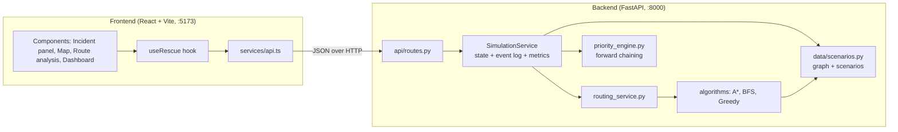
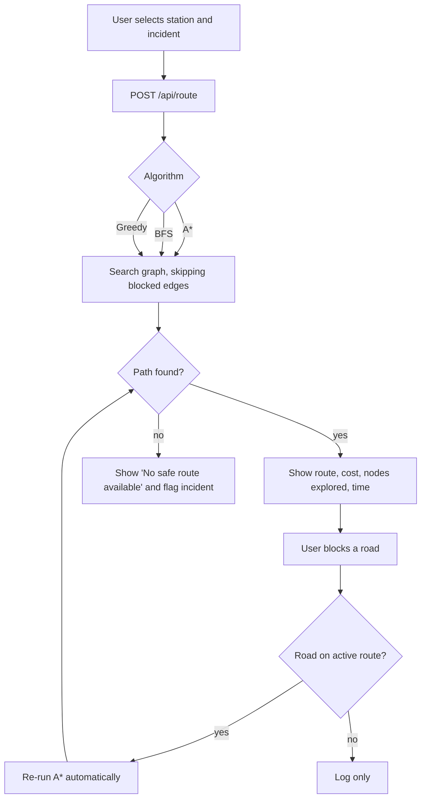

# RescueRoute AI: Intelligent Disaster Rescue Planner

RescueRoute AI is a **simulation and academic demonstration** of AI-assisted disaster response. It uses classical search algorithms (BFS, Greedy Best-First, A\*) and a transparent rule-based priority engine to plan rescue routes across a simulated road network while roads are blocked and re-opened.

> It is **not** an emergency dispatch system. The road graph, incidents and risk scores are simulated. No live emergency data, paid APIs, API keys or physical drones are used.

## Problem statement

During floods, fires and earthquakes, roads become unsafe, many locations need help at once, and a route that was safe a minute ago may be gone. Rescue teams need (1) a good route, (2) a fresh route the moment the old one is blocked, and (3) a defensible order in which to serve incidents. This project demonstrates how classical AI handles those three problems and lets you measure the algorithms against each other.

## Features and unique selling points

- Interactive map (React Leaflet + OpenStreetMap tiles) with an **offline schematic-grid fallback** (auto-switches if tiles fail; toggle any time). Roads, incidents and stations work identically in both modes.
- Three scenarios (Flood, Urban Fire, Earthquake) with different blocked roads, incident positions and severities.
- Route calculation with **A\***, **BFS** or **Greedy Best-First**, run by the Python backend (the frontend never re-implements them).
- **Algorithm comparison** on identical inputs: cost, path length, nodes explored, median execution time, optimality.
- **USP 1 – Dynamic replanning:** blocking a road on the active route automatically re-runs A\*, shows the previous route (dashed orange), logs it, and shows **"No safe route available"** when no alternative exists. A blocked route is never shown as valid.
- **USP 2 – Rule-based priority engine:** forward-chaining rules (R0-R7) assign Critical/High/Medium/Low priority, show *which rule* produced it, remove resolved incidents from the queue and flag unreachable incidents for alternative access planning. This is rule-based reasoning, **not machine learning**.
- **USP 3 – Scenario simulator:** load scenarios, add/remove blockages (click roads), generate reproducible random incidents (fixed seed + counter), run a multi-incident dispatch demo, reset to a known state.
- **Optional – Risk-aware routing:** `edge_cost = travel_cost + risk_weight × risk_score` with an adjustable weight and a shortest-vs-risk-aware comparison. Risk scores are simulated.
- Dashboard with summary cards, charts of *measured* metrics, and a timestamped event log.

## Technology stack

| Layer | Tools |
|---|---|
| Frontend | React 18, TypeScript, Vite, Tailwind CSS 3, Lucide icons, React Leaflet / Leaflet, Recharts |
| Backend | Python 3.10+, FastAPI, Uvicorn, Pydantic v2, standard library for the algorithms |
| Tests | Pytest (+ httpx test client), Vitest + React Testing Library |
| Storage | In-memory simulation state (lock-protected); no database |

## Architecture



The **backend is the single source of truth**: every mutating endpoint returns the full state snapshot (graph, blocked roads, incidents with priorities, active route, metrics, events). The frontend ignores responses older than what it already shows.



### Folder structure

```
.
├── README.md  requirements.txt  package.json  index.html  pytest.ini
├── vite.config.ts  tailwind.config.ts  postcss.config.js  tsconfig.json
├── frontend/src/
│   ├── components/   Header, IncidentPanel, RescueMap, MapLegend, RouteAnalysis,
│   │                 PerformanceDashboard, AlgorithmComparison, EventLog
│   ├── hooks/useRescue.ts      state + actions (stale-response protection)
│   ├── services/api.ts         the only module that talks to the backend
│   ├── types/  utils/  test/   App.tsx  main.tsx  index.css
├── backend/
│   ├── app/main.py             FastAPI app, CORS, error handlers
│   ├── app/api/routes.py       endpoints
│   ├── app/algorithms/         graph.py, astar.py, bfs.py, greedy_best_first.py
│   ├── app/services/           routing_service, priority_engine, simulation_service
│   ├── app/models/schemas.py   Pydantic request/response models
│   ├── app/data/scenarios.py   road network + scenarios
│   └── tests/                  test_algorithms.py, test_api.py, test_simulation.py
├── experiments/run_experiments.py   reproducible CSV experiment
└── docs/                       architecture.md, research_experiment_plan.md
```

## AI algorithms

The graph has intersections as nodes and road segments as undirected edges with `travel_cost` (km-equivalent) and a simulated `risk`. Blocked edges are never traversed by any algorithm. Each algorithm returns: path, cost, nodes explored, execution time (`time.perf_counter_ns`), success flag.

**A\*** orders a priority queue by `f(n) = g(n) + h(n)`, tracks the best known `g` per node and parent pointers, and skips blocked edges.

*Heuristic:* `h(n)` is the straight-line (haversine) distance to the destination. Every edge's cost is generated as `distance × m` with `m ≥ 1`, so no road is cheaper than the straight line: `h` never over-estimates (admissible) and satisfies the triangle inequality (consistent). A\* is therefore optimal for this cost model. Risk-aware mode only *adds* a non-negative term, so admissibility still holds. The tests verify this (`heuristic_is_admissible`) and cross-check A\* against Dijkstra on random grids.

**Breadth-First Search** expands level by level with a FIFO queue. It minimises the **number of road segments**, *not* total cost; with unequal edge costs its route may be costlier than A\*'s.

**Greedy Best-First Search** expands the node with the smallest `h(n)` only, ignoring cost so far. It often explores few nodes but is **not guaranteed optimal**.

| | Optimises | Uses heuristic | Optimal cost? | Typical exploration |
|---|---|---|---|---|
| BFS | fewest segments | no | no (weighted edges) | high |
| Greedy | nothing (follows h) | yes | no | low |
| A\* | total cost | yes (admissible) | **yes** | between |

*"Typical" is a qualitative expectation; see the experiment script for measurements.* Execution times on this small graph are dominated by measurement noise, so the comparison reports the **median of 25 runs**.

### Priority rules (forward chaining)

Facts: severity, people affected, resolved, route availability (reachable from any station). Rules fire repeatedly until nothing changes; rules only ever raise priority, so it terminates.

| Rule | Condition → effect |
|---|---|
| R0 | Resolved → removed from active queue |
| R1–R4 | severity critical/high/medium/low → priority Critical/High/Medium/Low |
| R5 | priority High **and** ≥ 25 people → Critical (chained on R2) |
| R6 | priority Medium **and** ≥ 15 people → High (chained on R3) |
| R7 | no route from any station → flag for alternative access planning |

## Setup

Requirements: Python 3.10+, Node.js 18+ and npm. Run everything from the repository root.

### Windows (PowerShell)

```powershell
python -m venv .venv
.venv\Scripts\Activate.ps1
pip install -r requirements.txt
npm install
```

Terminal 1 (backend):
```powershell
uvicorn app.main:app --reload --app-dir backend
```
Terminal 2 (frontend):
```powershell
npm run dev -- --host 127.0.0.1
```

### Linux / macOS

```bash
python3 -m venv .venv
source .venv/bin/activate
pip install -r requirements.txt
npm install
```
```bash
uvicorn app.main:app --reload --app-dir backend     # terminal 1
npm run dev -- --host 127.0.0.1                      # terminal 2
```

> The module path is `app.main:app` (module `app.main`, object `app`).

### URLs

| What | URL |
|---|---|
| Application | http://localhost:5173 |
| Backend API | http://127.0.0.1:8000 |
| Interactive API docs | http://127.0.0.1:8000/docs |

CORS allows `http://localhost:5173` and `http://127.0.0.1:5173`. To point the UI at another backend, set `VITE_API_BASE_URL` (see `.env.example`).

## Example demonstration workflow

1. Open http://localhost:5173 (Flood scenario loads).
2. Click incident **INC-001**. A route from the selected station is calculated with A\* and drawn in cyan with numbered waypoints.
3. Press **Run algorithm comparison**. Compare cost, nodes explored and optimality in the table; BFS/Greedy routes appear as dotted/dashed overlays.
4. Press **Demo: block a road on this route**. The route is invalidated and A\* replans; the old route is dashed orange and the log shows *Road blocked* and *Route recalculated*.
5. To show failure: use **Add blockage** and click every road around the destination → **No safe route available**; the incident is flagged for alternative access. Click a red road to restore it.
6. **Resolve** the incident, press **New incident** (reproducible), run the **Multi-incident demo**.
7. Switch scenarios; press **Reset simulation** (restores the scenario, clears metrics and log).

## Tests

```bash
pytest                 # backend: algorithms, priority engine, simulation, API (50 tests)
npm test               # frontend: Vitest + React Testing Library (10 tests)
npm run build          # TypeScript type-check + production build
```

(Counts are those from the last run during development; re-run to confirm on your machine.)

## Research experiment

```bash
python experiments/run_experiments.py                                  # default grid
python experiments/run_experiments.py --trials 30 --out experiments/results/run1.csv
```

Runs all three algorithms on generated graphs with fixed seeds, identical endpoints/blockages per trial, records failures, and writes a CSV. See [docs/research_experiment_plan.md](docs/research_experiment_plan.md). No results are bundled; generate them yourself.

## Interpreting dashboard metrics

- **Active / Critical / Resolved incidents, Blocked roads:** current simulation state.
- **Successful routes / Failed searches:** counts of recorded algorithm runs (route, replan, comparison, demo) that did / did not find a path.
- **Avg path cost / Avg nodes explored:** means over recorded runs, so they mix algorithms used. Use the per-algorithm chart for fair comparison.
- **Chart:** per-algorithm averages of execution time, nodes explored or cost, taken from real executions since the last metrics reset. Times of microseconds are noisy.
- **Estimated travel time:** `travel cost ÷ 40 km/h`, a simulation estimate only.

## Known limitations

- The road graph is a simulated 6×7 grid overlay, not real OpenStreetMap roads.
- Risk scores and travel-time estimates are simulated assumptions.
- Single shared in-memory simulation (one user at a time); restarting the backend resets it.
- The demo dispatch assumes unlimited station capacity and does not model vehicles or time.
- Timing on a ~40-node graph is noise-dominated.
- Automated browser (end-to-end) tests are not included.

## Future improvements

Real road graphs from OSM exports, multi-vehicle assignment, time-varying hazards, persistence, more heuristics (e.g. D\* Lite for incremental replanning), Playwright end-to-end tests.

## Publishing to GitHub

```bash
git init
git add .
git commit -m "RescueRoute AI prototype"
git branch -M main
git remote add origin https://github.com/<your-user>/rescue-route-ai.git
git push -u origin main
```
`.gitignore` already excludes `.venv`, `node_modules`, `dist` and generated CSVs.
